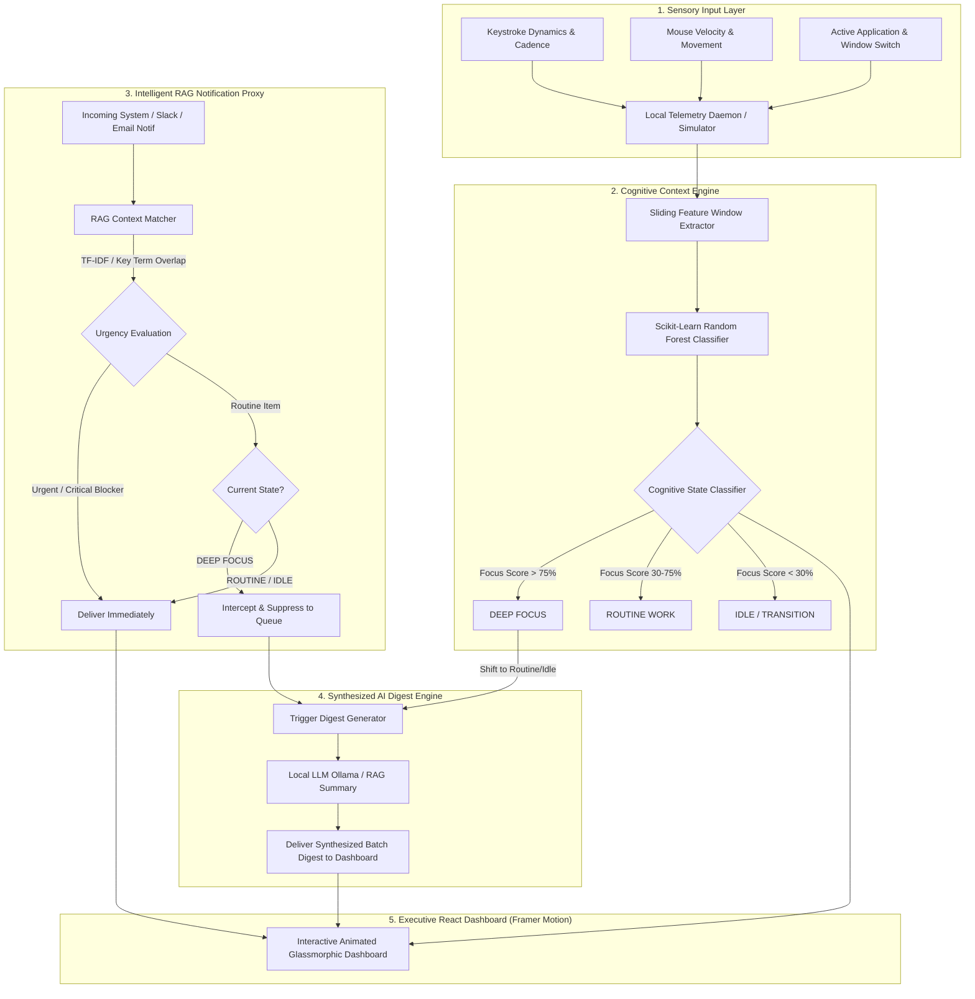

# 🧠 Cognitive Flow-State Orchestrator
> **Local, Privacy-First Desktop Agent for Cognitive Load Telemetry, Flow-State Mapping, and Intelligent Notification Interception.**

[](https://unstop.com)
[](https://python.org)
[](https://fastapi.tiangolo.com)
[](https://reactjs.org)
[](https://framer.com/motion)
[](https://scikit-learn.org)

---

## 1. Executive Summary & Problem Statement

Modern knowledge workers operate in a state of **continuous partial attention**. Extraneous cognitive load—caused by constant Slack notifications, context switching, and fragmented email alerts—exhausts working memory and prevents deep focus.

Static "Do Not Disturb" rules are rigid and binary, requiring manual activation and blocking all communication indiscriminately.

**Cognitive Flow-State Orchestrator** replaces static rules with **dynamic behavioral mapping**. It locally tracks real-time keyboard cadence, mouse dynamics, and window switching to classify user focus into three tiers:
1. **DEEP FOCUS**: Suppresses non-urgent notifications; intercepts and queues routine messages.
2. **ROUTINE WORK**: Passes through incoming communications live during multitasking.
3. **IDLE / TRANSITIONING**: Automatically generates a synthesized AI RAG digest summarizing all suppressed messages when focus wanes.

---

## 2. Solution Architecture & Telemetry Pipeline



---

## 3. Key Technical Components

| Component | Technology | Description |
| :--- | :--- | :--- |
| **Sensory Input Layer** | Python (`pynput`, `psutil`, `win32gui`) | Captures keystroke cadence, mouse pixels/min, and active application titles in 5-second sliding windows. |
| **Cognitive Engine** | Scikit-Learn (Random Forest) | Machine Learning model trained on synthetic baseline behavioral data. Predicts state (`DEEP_FOCUS`, `ROUTINE_WORK`, `IDLE`), `Focus Score` (0-100), and `Extraneous Load` (0-100). |
| **RAG Triage Proxy** | TF-IDF / Scikit-Learn / Ollama | Compares incoming message content against active user task context. Filters urgent blockers from routine noise. |
| **Backend API** | FastAPI + WebSockets | Low-latency REST & WebSocket server for real-time telemetry streaming and state change broadcasting. |
| **Frontend UI** | React 18 + Framer Motion + Recharts | Animated glassmorphic dashboard with dynamic canvas background web, fluid state badges, and spring transitions. |

---

## 4. Quickstart & Installation

```bash
# 1. Activate environment and start backend API daemon
.\.venv\Scripts\activate
python run.py

# 2. Launch React Frontend Dashboard (in /frontend directory)
cd frontend
npm run dev
```

Open your browser to **`http://localhost:3000`** to experience the animated dashboard!
